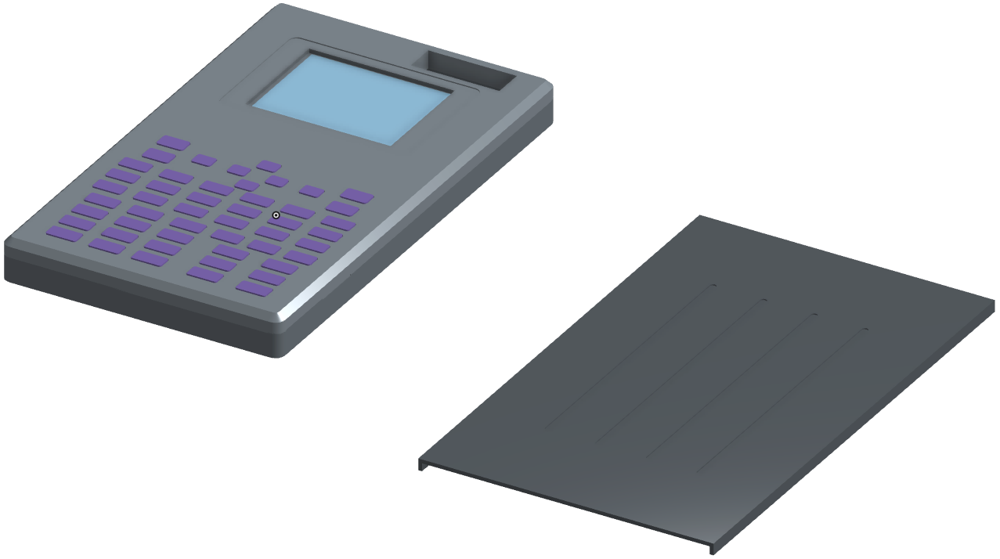

# ∇Calc

A handheld scientific calculator built around an ESP32-S3, featuring a 2.2-inch SPI display, an OV5640 camera for snapping equations, and a custom 4-layer PCB inside a 3D-printed case.

## Why I built this

Phones have calculator apps, but pulling out a phone while studying is an immediate distraction. On the other hand, traditional scientific calculators are expensive and lack the modern features and tech we have today.

I wanted to make a dedicated desk tool with modern open hardware (ESP32-S3, USB-C, SPI screen) and physical keys. The camera is tucked behind a sliding shutter just to snap math problems from textbooks or notes when needed.

## Current Status

This is a complete hardware design ready for prototype fabrication:

- **PCB:** Custom 4-layer board (84 × 85 mm) designed in EasyEDA Pro, fully routed and DRC-clean.
- **Case:** Multi-part 3D model designed in Onshape with a sliding camera shutter.
- **Keyboard:** The PCB has the matrix routing and MCP23017 expander for a 7×7 layout. The physical tactile membrane and keymat will be built once the components arrive.
- **Firmware:** ESP-IDF base with I2C and SPI peripheral setup.

## Hardware

- **MCU:** ESP32-S3-WROOM-1-N16R8 (16 MB Flash, 8 MB PSRAM)
- **Display:** 2.2-inch 320×240 TFT LCD (ILI9341 via SPI)
- **Camera:** 5 MP OV5640 autofocus module (DVP) with a mechanical cover
- **Power:** USB-C charging with TP4056 and TPS63001 buck-boost (3.3V rail)
- **Storage:** MicroSD slot (SPI)
- **Keypad:** 7×7 matrix via MCP23017 I2C expander

## Build costs and grants

### Phase 1: Motherboard & Core Modules (Approved Grant: $116.00)

I went with the JLC Top PCBA for the mainboard because I do not have experience soldering the small parts myself. The minimum order gave five boards and two Top assemblies. I will do the Bottom side later.

| Item                                                       | Price (USD) |
| :--------------------------------------------------------- | ----------: |
| JLC Top PCBA: 5 PCBs + 2 Top assemblies, with the ESP32-S3 |       86.18 |
| Bottom components for the two boards                       |        4.43 |
| Battery, camera, display, FPC cables and screws            |       24.51 |
| **Phase 1 Subtotal (Without shipping or taxes)**           |  **115.12** |

The parts list, links and price evidence are in [external parts](hardware/procurement/NablaCalc_External_Parts.csv).

---

### Phase 2: Keyboard Sub-PCB & 3D Enclosure

This second phase covers the dedicated tactile keyboard sub-board and the modular 3D-printed enclosure. The numbers below reflect live cart checkouts with consolidated shipping and discount coupons:

| Item                                                                    | Supplier         | Price (USD) |
| :---------------------------------------------------------------------- | :--------------- | ----------: |
| Keyboard PCB (2 layers, 0.8 mm bare PCB)                                | JLC One          |        4.00 |
| SLA Imagine Black enclosure (5 parts: front, rear, keys, slider, cover) | JLC One (JLC3DP) |       17.92 |
| Combined shipping (PCB + 3D prints in one parcel)                       | JLC One          |       14.92 |
| Applied JLC One discount coupon                                         | JLC One          |      -10.00 |
| 50x Tactile switches (TS2306A 240gf)                                    | LCSC             |        3.74 |
| LCSC shipping & handling fee                                            | LCSC             |       13.06 |
| **Phase 2 Subtotal (Delivered cart total)**                             |                  |   **43.64** |

> Note: The 14-pin FPC connector was covered by the 5-piece MOQ in the Phase 1 motherboard connector order, so only the 50 tactile switches are needed for Phase 2. Checkout screenshots are in [evidence](hardware/procurement/evidence/).

### Total Project Summary

| Phase                     | Description                                              | Cost (USD) |
| :------------------------ | :------------------------------------------------------- | ---------: |
| Phase 1                   | Motherboard PCBA & core modules                          |     115.12 |
| Phase 2                   | Dedicated keyboard PCB, tactile switches & SLA enclosure |      43.64 |
| **Total Project Funding** | **Complete handheld calculator build**                   | **158.76** |

## Links

- [EasyEDA PCB Source](hardware/pcb/source/NablaCalc_PCB.epro2) & [Schematic](hardware/pcb/source/NablaCalc_Schematic.epro2)
- [Fabrication Gerbers & BOM](hardware/pcb/)
- [Keyboard Sub-PCB (Phase 2)](hardware/segunda_pcb/)
- [Modular 14mm Enclosure](mechanical/modular_14mm/)
- [Onshape 3D Assembly](https://cad.onshape.com/documents/be7a87a9d96ccf13f21109ba/w/9bc3f60f30bb3c6fc0782a9f/e/171b42404c6dac75f5344efb?renderMode=0&uiState=6ad259f9f57eaa6f0919b303)
- [Firmware Source](firmware/nabla_firmware/)
